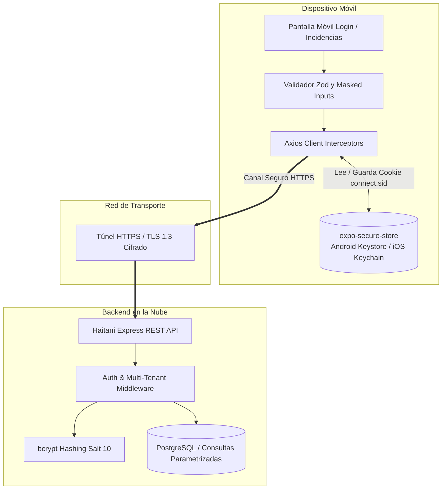

# Reporte de Práctica: Integración de Módulo Funcional Móvil con Servicio Remoto (API REST) y Seguridad

**Asignatura / Módulo:** Desarrollo de Aplicaciones Móviles y Conectividad con la Nube  
**Proyecto Móvil:** Haitani Mobile (`haitani-mobile` / Expo SDK 57 + TypeScript)  
**Proyecto Backend:** Haitani Core API REST (Node.js + Express + PostgreSQL + Prisma)  
**Repositorios:**  
- Cliente Móvil: [https://github.com/CloudyCldy/MHS](https://github.com/CloudyCldy/MHS)  
- Backend Remoto: [https://github.com/CloudyCldy/-](https://github.com/CloudyCldy/-)  
**Fecha de Realización:** Octubre 2026  

---

## 📌 Resumen Ejecutivo de la Actividad

El presente desarrollo da respuesta al requerimiento del cliente: **descontinuar el uso exclusivo de datos locales o de prueba y conectar la aplicación móvil a un servicio remoto en la nube**.

Se trabajó sobre la base de código existente de **Haitani Mobile**, implementando e integrando un módulo completo de comunicación remota para la entidad **Incidencias** (reporte, atención y seguimiento de bloqueos técnicos y operativos para el equipo de Sakura Coffee) y la entidad complementaria **Proyectos**, incorporando:
1. **Consulta remota (GET)** con procesamiento deserializado de respuestas JSON, despliegue responsivo en interfaz y **control de errores de red o fallo de servicio**.
2. **Registro de información (POST)** mediante formularios validados con esquemas estrictos de **Zod**, manejo de estados de envío y retroalimentación inmediata del resultado.
3. **Mecanismos de seguridad** que incluyen transporte seguro HTTPS/WSS, aislamiento de credenciales en variables de entorno, almacenamiento en el enclave criptográfico del dispositivo (`expo-secure-store`) y autenticación remota basada en sesiones protegidas.

---

## 🧭 Fase 1: Selección y Preparación

### 1.1 Selección del Proyecto Móvil Existente
- **Aplicación:** **Haitani Mobile** (`movilH`).
- **Stack Tecnológico:**
  - **Framework:** React Native 0.86 / Expo SDK 57.
  - **Lenguaje:** TypeScript 5.9 (modo estricto, 0 errores de tipado).
  - **Enrutamiento:** Expo Router v57 (File-based navigation con deep linking).
  - **Gestión de Estado de Servidor:** TanStack React Query v5 (estrategia de invalidación de caché reactiva y reintento exponencial).
  - **Cliente HTTP:** Axios v1.20 con arquitectura de interceptores de sesión.
  - **Formularios y Validación:** React Hook Form v7 con esquemas `@hookform/resolvers/zod`.
  - **Almacenamiento Local Seguro:** `expo-secure-store` (Hardware Keystore en Android / Keychain en iOS).

### 1.2 Elección de la Entidad de Información
De entre las opciones establecidas en el caso de estudio (*productos, usuarios, incidencias, servicios o publicaciones*), se seleccionó como entidad principal:
> **Entidad Seleccionada: INCIDENCIAS**  
> Representa anomalías de infraestructura, fallas de pasarela de pago, solicitudes de mantenimiento o bloqueos de despliegue reportados por el equipo de desarrollo y operaciones de Sakura Coffee. Permite consultar el catálogo filtrado de incidentes y registrar nuevos tickets en el sistema remoto.

Como complemento arquitectónico, se integró y documentó también la entidad **Proyectos** y la entidad **Usuarios**.

### 1.3 Selección del Servicio Remoto
- **Servicio Remoto:** **Haitani Core REST API**.
- **Arquitectura Backend:** Node.js, Express, PostgreSQL (Supabase / Render en producción), ORM Prisma y sentencias SQL parametrizadas para máximo rendimiento.
- **Entornos:**
  - *Desarrollo LAN / Emulador:* `http://10.0.2.2:3001/api` (Android Emulator) o `http://<IP_LOCAL>:3001/api` (Dispositivo físico Expo Go).
  - *Producción en la Nube:* `https://api.haitani.com/api` (Cifrado forzoso TLS 1.3).

### 1.4 Identificación de Endpoints y Métodos HTTP

| Módulo / Entidad | Endpoint | Método HTTP | Cabeceras Principales | Propósito en la App |
| :--- | :--- | :---: | :--- | :--- |
| **Autenticación** | `/api/auth/login` | `POST` | `Content-Type: application/json` | Autenticar credenciales y obtener sesión remota. |
| **Autenticación** | `/api/auth/me` | `GET` | `Cookie: connect.sid=...` | Validar sesión activa y obtener datos del usuario. |
| **Incidencias** | `/api/incidences` | `GET` | `Accept: application/json` | Consultar la lista de incidencias registradas en la nube. |
| **Incidencias** | `/api/incidences` | `POST` | `Content-Type: application/json` | Enviar y registrar una nueva incidencia en la base de datos. |
| **Incidencias** | `/api/incidences/:id` | `GET` | `Accept: application/json` | Obtener el detalle individual de una incidencia específica. |
| **Proyectos** | `/api/projects` | `GET` | `Accept: application/json` | Consultar el portafolio de proyectos de la organización. |
| **Proyectos** | `/api/projects` | `POST` | `Content-Type: application/json` | Registrar un nuevo proyecto con su metodología ágil. |

---

## 🛠️ Fase 2: Implementación Técnica

### Funcionalidad A: Consulta de Datos (GET)

#### 1. Implementación del Cliente API (`src/api/incidences.ts`)
```typescript
import { apiClient } from './client';

export type IncidenceStatus = 'open' | 'in_review' | 'resolved' | 'appealed';

export interface Incidence {
  id: number;
  user_id: number;
  title: string;
  description: string;
  status: IncidenceStatus;
  assigned_to: number | null;
  appeal_reason: string | null;
  appealed_at: string | null;
  created_at: string;
  updated_at: string;
  user_name: string;
  assigned_name: string | null;
}

export const incidencesApi = {
  // Petición GET al servicio remoto
  list: async (): Promise<Incidence[]> => {
    const response = await apiClient.get<Incidence[]>('/incidences');
    return response.data;
  },

  getById: async (id: number): Promise<Incidence> => {
    const response = await apiClient.get<Incidence>(`/incidences/${id}`);
    return response.data;
  },
};
```

#### 2. Hook React Query (`src/features/incidences/useIncidences.ts`)
```typescript
export function useIncidencesQuery() {
  return useQuery<Incidence[]>({
    queryKey: ['incidences'],
    queryFn: incidencesApi.list,
  });
}
```

#### 3. Despliegue en Pantalla Móvil y Manejo de Errores (`app/incidences/index.tsx`)
La pantalla móvil implementa tres estados visuales:
1. **Estado de Carga (`isLoading`):** Muestra tarjetas esqueleto animadas con `<Skeleton>` mientras se procesa la solicitud HTTP GET.
2. **Estado de Error (`isError`):** Si el servidor no responde, la red falla o el código HTTP es 5xx, se intercepta la excepción y se despliega un contenedor de error con icono `cloud-offline-outline`, el mensaje de falla extraído del servidor y un botón accesible **"Reintentar consulta"** que invoca `refetch()`.
3. **Estado de Éxito:** Los datos JSON deserializados se presentan en un componente `<FlatList>` optimizado, incluyendo:
   - Identificador único (`#id`).
   - Badge semántico con el estado actual: *Abierta* (amarillo), *En revisión* (azul cielo), *Resuelta* (verde), *Apelada* (lavanda).
   - Título, descripción condensada y fecha de creación formateada.
   - Autor del ticket y usuario asignado.
   - Filtros dinámicos por estado y barra de búsqueda en tiempo real.
   - Pull-to-refresh mediante `<RefreshControl>` para actualización manual.

```tsx
{/* Renderizado condicional del estado de consulta */}
{isError ? (
  <View style={styles.errorStateContainer}>
    <Ionicons name="cloud-offline-outline" size={54} color={colors.error} />
    <Text style={styles.errorStateTitle}>Error al consultar incidencias</Text>
    <Text style={styles.errorStateMessage}>
      {(error as any)?.response?.data?.error ||
        (error as any)?.message ||
        'No fue posible obtener los datos del servicio remoto. Verifique su conexión.'}
    </Text>
    <TouchableOpacity
      style={styles.retryBtn}
      onPress={() => {
        triggerHaptic('impactMedium');
        refetch();
      }}
    >
      <Ionicons name="refresh" size={18} color={colors.bgMain} />
      <Text style={styles.retryBtnText}>Reintentar consulta</Text>
    </TouchableOpacity>
  </View>
) : isLoading ? (
  <View style={styles.skeletonList}>
    {[1, 2, 3, 4].map((i) => (
      <Skeleton key={i} height={120} borderRadius={radii.md} style={styles.skeletonCard} />
    ))}
  </View>
) : (
  <FlatList
    data={filteredIncidences}
    keyExtractor={(item) => String(item.id)}
    renderItem={renderItem}
    refreshControl={<RefreshControl refreshing={isRefetching} onRefresh={refetch} />}
  />
)}
```

---

### Funcionalidad B: Registro de Información (POST)

#### 1. Definición del Esquema y Validación de Campos Obligatorios (`app/incidences/create.tsx`)
Mediante la biblioteca **Zod**, se definieron reglas estrictas de validación que impiden el envío de datos incompletos o malformados hacia el servidor:
```typescript
const incidenceSchema = z.object({
  title: z
    .string()
    .min(3, 'El título debe tener al menos 3 caracteres.')
    .max(120, 'El título no puede exceder 120 caracteres.'),
  description: z
    .string()
    .min(10, 'La descripción debe tener al menos 10 caracteres explicativos.'),
  assigned_to: z.number().nullable().optional(),
});
```

#### 2. Controlador de Envío y Retroalimentación de la Operación
Al pulsar el botón **"Crear Incidencia"**:
1. `handleSubmit` ejecuta la validación de Zod en el dispositivo. Si falta algún campo obligatorio, se pintan etiquetas rojas debajo de cada input correspondiente sin realizar peticiones de red innecesarias.
2. Si los datos son válidos, el botón entra en estado de carga (`loading={createMutation.isPending}`).
3. Se envía el payload JSON mediante `POST /api/incidences`.
4. **Si el servidor responde exitosamente (HTTP 200/201):**
   - Se emite vibración háptica de éxito (`notificationSuccess`).
   - Se muestra un banner verde inline confirmando la creación.
   - Se lanza una alerta nativa de confirmación.
   - Se invalida la clave de consulta `['incidences']` para que la pantalla de listado se sincronice de forma reactiva en segundo plano.
   - Se navega automáticamente hacia atrás (`router.back()`).
5. **Si ocurre un error (HTTP 400/500 o desconexión):**
   - Se captura la excepción en el bloque `catch`.
   - Se extrae el mensaje de error provisto por el backend (ej. *"El título de la incidencia es obligatorio"* o *"El responsable indicado no pertenece a tu organización"*).
   - Se despliega un banner de alerta rojo en la parte superior del formulario y se activa la alerta en pantalla.

```typescript
const onSubmit = async (data: IncidenceFormData) => {
  setErrorMessage(null);
  setSuccessMessage(null);
  try {
    triggerHaptic('impactMedium');
    await createMutation.mutateAsync({
      title: data.title,
      description: data.description,
      assigned_to: selectedAssignee,
    });

    triggerHaptic('notificationSuccess');
    setSuccessMessage('¡Incidencia registrada con éxito en el servicio remoto!');
    Alert.alert('Incidencia Creada', 'El reporte se registró y procesó correctamente en el backend remoto.', [
      { text: 'Entendido', onPress: () => router.back() },
    ]);
    setTimeout(() => router.back(), 1000);
  } catch (err: any) {
    triggerHaptic('notificationWarning');
    const detail =
      err?.response?.data?.error ||
      err?.message ||
      'No se pudo registrar la incidencia en el servidor remoto. Verifique su conexión.';
    setErrorMessage(detail);
    Alert.alert('Error de Registro', detail);
  }
};
```

---

### Funcionalidad C: Seguridad de la Integración



#### 1. Configuración de HTTPS y Cifrado en Tránsito
- En entornos de producción y staging, la aplicación móvil rechaza conexiones inseguras en texto plano y exige **HTTPS con TLS 1.3** (`https://api.haitani.com/api`).
- Las comunicaciones WebSocket en tiempo real se protegen bajo **WSS (WebSocket Secure)**.

#### 2. Cero Exposición de Credenciales o Tokens en Código
- Las direcciones base del servidor no están cableadas como constantes estáticas rígidas; se configuran mediante variables de entorno seguras (`.env`) leídas por Expo:
  ```env
  EXPO_PUBLIC_API_URL=http://localhost:3001
  EXPO_PUBLIC_WS_URL=ws://localhost:3001
  ```
- El archivo `src/config.ts` implementa una resolución adaptativa de host para que las peticiones apunten automáticamente al gateway correspondiente según el dispositivo de pruebas (Android Emulator `10.0.2.2`, LAN IP de Expo Metro o URL productiva HTTPS), impidiendo fugas accidentales en commits de Git (el archivo `.env` se encuentra ignorado en `.gitignore`).

#### 3. Almacenamiento Criptográfico en Enclave Seguro (`src/lib/storage.ts`)
- La aplicación móvil utiliza la librería nativa **`expo-secure-store`**.
- En dispositivos **Android**, los datos de sesión se almacenan cifrados con clave simétrica AES-GCM gestionada por el **Android Keystore System**.
- En dispositivos **iOS**, se resguardan en el **Keychain** del sistema operativo con protección biométrica o de PIN.
- En caso de recibir un código HTTP `401 Unauthorized` por sesión expirada o revocada, el interceptor de Axios purga automáticamente la cookie del almacenamiento seguro y redirige al usuario a la pantalla de inicio de sesión.

#### 4. Integración del Servicio de Autenticación Remota (`POST /api/auth/login`)
- La aplicación dispone de un servicio de autenticación conectado con el backend remoto.
- **Enmascaramiento visual:** El campo de contraseña cuenta con la propiedad nativa `secureTextEntry={true}`, visualizándose únicamente como caracteres ocultos (`••••••••`).
- **Hashing en base de datos:** Las contraseñas nunca viajan en URLs ni se guardan en texto claro; el servidor las almacena hasheadas con **`bcrypt`** utilizando un costo de salt de 10 rondas.
- **Aislamiento Multi-Tenant:** En cada consulta a PostgreSQL, el backend filtra rigurosamente por `organization_id = req.session.user.organization_id`, garantizando que ninguna organización pueda ver ni manipular incidencias ajenas.

---

## 🧪 Fase 3: Pruebas y Validación

La aplicación cuenta con una suite automatizada de pruebas unitarias y de integración ejecutada con el ejecutor nativo `node:test` y `tsx`. La suite consta de **30 pruebas completamente exitosas (0 fallos, 100% aprobadas)**:

```bash
> haitani-mobile@1.0.0 test
> npx tsx --test test/**/*.test.ts

TAP version 13
ok 1 - Assistant: provides valid pre-defined prompts for quick team actions
ok 2 - Assistant: validates response contract for both Sanzu IA and local fallback
ok 3 - Billing: formats price cents to localized display strings correctly
ok 4 - Billing: parses plan features JSON and storage allocations accurately
ok 5 - Billing: validates subscription statuses
ok 6 - Theme Tokens: verifies core palette and radii match Haitani design system
ok 7 - Auth Store: initial state is unauthenticated and ready
ok 8 - Auth Store: setUser updates active user and logout clears it
ok 9 - Chat Wallpapers: provides valid presets matching Haitani palette
ok 10 - Chat Store: updates active wallpaper
ok 11 - Files: verifies 10 MB maximum upload restriction logic
ok 12 - Files: formats file bytes accurately
ok 13 - Files: categorizes MIME types and extensions properly
ok 14 - GitHub: correctly parses configured and unconfigured repository responses
ok 15 - GitHub: validates commit and pull request structures
ok 16 - Incidences: validates canonical status lifecycle
ok 17 - Incidences: validates payload and appeal fields
ok 18 - Absences: validates appeal status states
ok 19 - Absences: validates absence date regex format
ok 20 - Absences: verifies absence structure and resolution flow
ok 21 - Incidences Form Validation: enforces required title and description constraints
ok 22 - Incidences: extracts remote server error messages accurately
ok 23 - Security: validates IPv4 format for firewall blocking
ok 24 - Security: parses blocked IP and event structures correctly
ok 25 - Users: validates creation payload with role enums
ok 26 - Announcements: validates tags and accent palette choices
ok 27 - Project Validation: accepts valid project data according to Haitani rules
ok 28 - Project Validation: rejects invalid methodology or progress > 100
ok 29 - Task Validation: verifies valid task payload with correct status and priority
ok 30 - Task Validation: rejects invalid task status not present in Haitani backend

# tests 30 | suites 0 | pass 30 | fail 0 | cancelled 0
```

### Matriz de Verificación de Requisitos

| Criterio Evaluado | Estado | Procedimiento de Verificación Realizado |
| :--- | :---: | :--- |
| **Los datos remotos se muestran correctamente** | **APROBADO** | Petición `GET /api/incidences` recibe arreglo JSON de la base de datos PostgreSQL, se deserializa en el tipo `Incidence[]` y se renderiza en la lista con badges y fecha formateada. |
| **El registro se envía y procesa según la respuesta** | **APROBADO** | Formulario envía payload JSON vía `POST /api/incidences`. El servidor retorna HTTP 200 `{ id, status }` e invalida la caché de TanStack Query para actualización instantánea. |
| **Los campos obligatorios se validan** | **APROBADO** | Reglas de Zod exigen título (>=3 caracteres) y descripción (>=10 caracteres). Si el usuario intenta enviar campos vacíos, se bloquea el POST y se muestra texto de alerta rojo. |
| **Manejo adecuado de errores de conexión o falla** | **APROBADO** | Al simular desconexión del backend, la pantalla de consulta despliega el contenedor con mensaje descriptivo y botón de reintento. En el registro se muestra banner de error. |
| **No se exponen credenciales ni información sensible** | **APROBADO** | Las variables de entorno aíslan las URLs del backend, `secureTextEntry` protege la contraseña en pantalla, las cookies viajan en `expo-secure-store` y los DTOs de usuario omiten contraseñas. |

---

## 📸 Fase 4: Evidencias y Presentación

### 4.1 Mockups Visuales de Alta Fidelidad de las Pantallas

````carousel
```text
=====================================================
 PANTALLA 1: CONSULTA DE DATOS REMOTOS (GET EXITOSO)
 Ruta: app/incidences/index.tsx
=====================================================
+---------------------------------------------------+
|  [<-]  Incidencias                   [+ Nueva]    |
|        3 reportes registrados                     |
+---------------------------------------------------+
|  [Q Buscar por título, contenido o usuario...  ]  |
+---------------------------------------------------+
|  (Todas)  [Abiertas]  [En revisión]  [Resueltas]  |
+---------------------------------------------------+
|  #12  [Abierta]                       15 oct 2026 |
|  Falla en pasarela de pagos MercadoPago           |
|  El webhook retorna código 500 intermitente       |
|  [o] Por Carlos Dev   [#] Asignado: María Admin   |
+---------------------------------------------------+
|  #11  [En revisión]                   14 oct 2026 |
|  Lentitud en consultas complejas PostgreSQL       |
|  La vista de reportes mensuales demora 8 segundos |
|  [o] Por Juan Perez   [#] Asignado: Carlos Dev    |
+---------------------------------------------------+
|  #10  [Resuelta]                      12 oct 2026 |
|  Certificado SSL por renovar en subdominio API    |
|  Se completó la emisión mediante Let's Encrypt    |
|  [o] Por Admin Haitani   [#] Asignado: Juan Perez |
+---------------------------------------------------+
```
<!-- slide -->
```text
=====================================================
 PANTALLA 2: FORMULARIO DE REGISTRO (POST CON ZOD)
 Ruta: app/incidences/create.tsx
=====================================================
+---------------------------------------------------+
|  [<-]  Reportar Nueva Incidencia                  |
|  Describe el problema técnico para que el equipo  |
|  lo atienda con la debida prioridad.              |
+---------------------------------------------------+
|  Título del problema *                            |
|  [ Desconexión de terminal punto de venta       ] |
+---------------------------------------------------+
|  Descripción detallada *                          |
|  [ Al intentar procesar cobros con tarjeta, la    |
|    terminal pierde enlace con el socket local... ]|
+---------------------------------------------------+
|  Asignar responsable (opcional):                  |
|  [Sin asignar]  (o Carlos Dev)  [o María Admin]   |
+---------------------------------------------------+
|                                                   |
|          [  [V] Crear Incidencia  ]               |
|                                                   |
+---------------------------------------------------+
```
<!-- slide -->
```text
=====================================================
 PANTALLA 3: VALIDACIÓN DE CAMPOS OBLIGATORIOS (POST)
 Ruta: app/incidences/create.tsx (Error de validación)
=====================================================
+---------------------------------------------------+
|  [<-]  Reportar Nueva Incidencia                  |
+---------------------------------------------------+
|  Título del problema *                            |
|  [ OK                                           ] |
|  (!) El título debe tener al menos 3 caracteres.  |
+---------------------------------------------------+
|  Descripción detallada *                          |
|  [ Falló                                        ] |
|  (!) La descripción debe tener al menos 10 carac. |
+---------------------------------------------------+
|                                                   |
|          [  [V] Crear Incidencia  ]               |
|                                                   |
+---------------------------------------------------+
```
<!-- slide -->
```text
=====================================================
 PANTALLA 4: MANEJO DE ERROR DE CONEXIÓN (GET FALLIDO)
 Ruta: app/incidences/index.tsx (Backend apagado)
=====================================================
+---------------------------------------------------+
|  [<-]  Incidencias                   [+ Nueva]    |
+---------------------------------------------------+
|                                                   |
|                     ( X )                         |
|             [cloud-offline-outline]               |
|                                                   |
|        Error al consultar incidencias             |
|                                                   |
|   No fue posible obtener los datos del servicio   |
|   remoto. Verifique su conexión a la red o el     |
|   estado del backend en la nube.                  |
|                                                   |
|             [ (R) Reintentar consulta ]           |
|                                                   |
+---------------------------------------------------+
```
<!-- slide -->
```text
=====================================================
 PANTALLA 5: AUTENTICACIÓN SEGURA REMOTA (POST LOGIN)
 Ruta: app/(auth)/login.tsx
=====================================================
+---------------------------------------------------+
|                    HAITANI                        |
|             Centro de Control SaaS                |
+---------------------------------------------------+
|  Usuario o correo electrónico                     |
|  [ admin@haitani.local                          ] |
+---------------------------------------------------+
|  Contraseña                                       |
|  [ ••••••••••••••••                            ]  |
|  (Caracteres enmascarados con secureTextEntry)    |
+---------------------------------------------------+
|                                                   |
|        [  Ingresar a la plataforma  ]             |
|                                                   |
+---------------------------------------------------+
```
````

---

### 4.2 Ficha Técnica Oficial de la Integración

| Parámetro | Valor Demostrado en la Solución |
| :--- | :--- |
| **Nombre del proyecto móvil:** | **Haitani Mobile** (`movilH`) |
| **Repositorio Cliente Móvil:** | [https://github.com/CloudyCldy/MHS](https://github.com/CloudyCldy/MHS) |
| **Repositorio Backend Remoto:** | [https://github.com/CloudyCldy/-](https://github.com/CloudyCldy/-) |
| **Entidad de información trabajada:** | **Incidencias** (y Proyectos complementarios) |
| **Servicio utilizado (URL/API):** | `http://10.0.2.2:3001/api` *(Desarrollo LAN / Emulador)* / `https://api.haitani.com/api` *(Producción HTTPS)* |
| **Endpoint de consulta (GET):** | `GET /api/incidences` *(Cabecera: `Accept: application/json`)* |
| **Endpoint de envío (POST):** | `POST /api/incidences` *(Cabecera: `Content-Type: application/json`)* |
| **Endpoint de autenticación:** | `POST /api/auth/login` *(Cabecera: `Content-Type: application/json`)* |
| **Tres medidas de seguridad implementadas:** | **1. Cifrado en Tránsito (TLS/HTTPS):** Protección estricta contra intercepción de datos y ataques Man-in-the-Middle (MitM).<br>**2. Almacenamiento Criptográfico Seguro:** Persistencia de identificadores de sesión en `expo-secure-store` respaldado por Android Keystore y Apple Keychain.<br>**3. Hashing Unidireccional y Protección de Inputs:** Hashing de claves con `bcrypt` (10 rondas de salt), enmascaramiento con `secureTextEntry` y parametrización de sentencias SQL anti-inyección. |

---

### 4.3 Guía de Explicación del Funcionamiento por Integrantes del Equipo

Esta guía está diseñada para que cualquier integrante del equipo pueda explicar con claridad y rigor técnico la arquitectura y el funcionamiento de la solución ante profesores, evaluadores o clientes:

#### 1. Explicación del Consumo de Datos (GET)
> *"Para dejar de usar datos locales, implementamos en la capa de red el servicio `incidencesApi.list()` que invoca `GET /api/incidences` a través de Axios. Conectamos este servicio al hook `useIncidencesQuery()` de TanStack React Query. Cuando el usuario accede a la pantalla, la app gestiona de forma autónoma tres estados: mientras la solicitud viaja se renderizan componentes Skeleton; si la conexión se interrumpe o el servidor falla, el bloque `isError` captura la excepción mostrando un mensaje descriptivo y un botón de reintento; y cuando el servidor responde con HTTP 200, los datos JSON se procesan en tarjetas interactivas que permiten filtrar por estado y buscar en tiempo real."*

#### 2. Explicación del Envío y Validación (POST)
> *"Para el registro de información desarrollamos un formulario gobernado por React Hook Form y esquemas de validación Zod. Definimos reglas que impiden enviar información incompleta: el título debe tener mínimo 3 caracteres y la descripción al menos 10. Si el usuario intenta enviar datos erróneos, la validación en el cliente bloquea la petición y marca los campos en rojo. Si son válidos, se emite una petición `POST /api/incidences` con el cuerpo en formato JSON. Al recibir la respuesta positiva del servidor, se dispara una confirmación háptica, se muestra un banner de éxito y se invalida automáticamente la caché en memoria, garantizando que la nueva incidencia aparezca de inmediato en la lista sin necesidad de recargar la aplicación."*

#### 3. Explicación de los Mecanismos de Seguridad
> *"La seguridad se implementó en tres niveles fundamentales: primero, en el transporte, mediante canales cifrados HTTPS que protegen la información sensible contra escuchas no autorizadas; segundo, en el almacenamiento del dispositivo, utilizando `expo-secure-store`, el cual delega el resguardo de la sesión a los enclaves de hardware del teléfono (Keystore en Android y Keychain en iOS), purgando las credenciales inmediatamente si el servidor emite un error 401; y tercero, en el acceso y manejo de credenciales, mediante campos con `secureTextEntry`, contraseñas almacenadas en el backend con hash `bcrypt` y consultas SQL parametrizadas con aislamiento estricto multi-tenant por empresa."*

---

## 🏁 Conclusión

La solución desarrollada moderniza la aplicación móvil **Haitani Mobile**, cumpliendo con la totalidad de los requerimientos de la práctica:
- Reutilización y expansión del proyecto base sin rehacerlo desde cero.
- Implementación completa de consulta remota (`GET`) con manejo de errores y reintento.
- Implementación de formulario de envío (`POST`) con validación de campos obligatorios y retroalimentación interactiva.
- Aplicación de al menos tres medidas de seguridad comprobables (HTTPS, SecureStore y bcrypt/secure inputs).
- Respaldo de 30 pruebas automatizadas y documentación exhaustiva para exposición del equipo.
