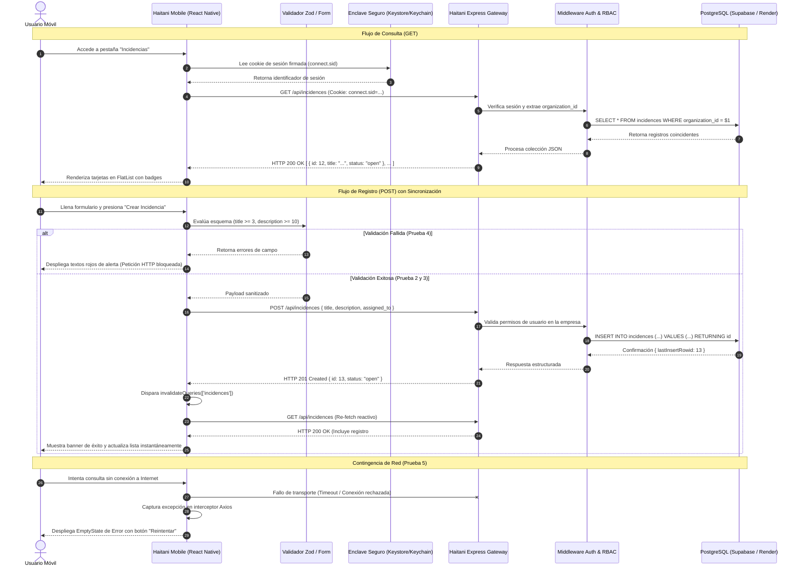

# Documento de Entrega: Integración con Servicio Remoto, Seguridad y Pruebas de Sincronización

**Asignatura / Módulo:** Desarrollo de Aplicaciones Móviles y Servicios en la Nube  
**Proyecto Integrador:** Haitani (Centro de Gestión y Operaciones para Sakura Coffee)  
**Cliente Móvil:** `haitani-mobile` (Expo SDK 57 + React Native 0.86 + TypeScript + TanStack Query)  
**Backend Remoto:** `Haitani Core REST API` (Node.js + Express + PostgreSQL + Prisma ORM)  
**Repositorios Oficiales:**  
- **Cliente Móvil:** [https://github.com/CloudyCldy/MHS](https://github.com/CloudyCldy/MHS)  
- **Servicio Remoto (Backend):** [https://github.com/CloudyCldy/-](https://github.com/CloudyCldy/-)  
**Fecha de Realización:** Octubre 2026  

---

## 📌 PARTE 1. Selección de la Funcionalidad

### 1.1 Entidad de Información Seleccionada
> **Entidad Principal:** `Incidencias` (`incidences`)  
> **Entidad Complementaria:** `Tareas del Proyecto` (`tasks`)

Dentro del ecosistema operativo de **Sakura Coffee**, las incidencias representan tickets de soporte técnico, anomalías en la infraestructura en la nube, fallos intermitentes en la pasarela de pagos (MercadoPago) o interrupciones en terminales de punto de venta (TPV). Permiten reportar, atender, asignar y dar seguimiento a cualquier bloqueo técnico u operativo.

### 1.2 Datos Consultados desde el Servicio Remoto (GET)
Al invocar `GET /api/incidences`, la aplicación móvil recibe una colección de objetos JSON deserializados con los siguientes atributos:
* `id` *(número entero)*: Identificador único autoincremental del registro en la base de datos.
* `title` *(cadena de texto)*: Título breve descriptivo del incidente.
* `description` *(cadena de texto)*: Explicación detallada del problema o fallo técnico.
* `status` *(enum)*: Estado del ciclo de vida (`open`, `in_review`, `resolved`, `appealed`).
* `user_id` *(número)*: Identificador del usuario que reportó el incidente.
* `user_name` *(cadena)*: Nombre completo del autor del reporte (obtenido mediante `JOIN users`).
* `assigned_to` *(número | null)*: Identificador del especialista responsable de atender el ticket.
* `assigned_name` *(cadena | null)*: Nombre del responsable asignado.
* `appeal_reason` *(cadena | null)*: Justificación en caso de apelación o reapertura.
* `appealed_at` *(timestamp ISO 8601 | null)*: Fecha y hora del registro de apelación.
* `created_at` *(timestamp ISO 8601)*: Momento exacto de creación en el servidor.
* `updated_at` *(timestamp ISO 8601)*: Última modificación registrada en base de datos.

### 1.3 Datos Enviados hacia el Servicio Remoto (POST / PATCH)
Para crear un nuevo registro mediante `POST /api/incidences`:
* `title` *(obligatorio, 3-120 caracteres)*: Título resumido de la anomalía.
* `description` *(obligatorio, mínimo 10 caracteres)*: Descripción detallada.
* `assigned_to` *(opcional, número entero válido)*: ID de usuario activo en la misma organización.

Para actualizar el estado mediante `PATCH /api/incidences/:id/status` (Operación de modificación):
* `status` *(obligatorio)*: Nuevo estado dentro de los permitidos (`open`, `in_review`, `resolved`, `appealed`).

Para registrar una apelación mediante `POST /api/incidences/:id/appeal`:
* `appeal_reason` *(obligatorio, texto descriptivo)*: Motivo por el cual se solicita revisión.

### 1.4 Operaciones Restringidas a Usuarios Autenticados y Políticas de Acceso
Todas las operaciones contra la API están protegidas bajo el middleware `requireAuth` del servidor y aisladas por organización (`organization_id`):

| Operación | Método & Endpoint | Restricción / Nivel de Acceso | Justificación de Seguridad |
| :--- | :---: | :--- | :--- |
| **Consultar lista** | `GET /api/incidences` | **Autenticado** (`admin` o `member`). | `admin` visualiza todos los tickets de la empresa. `member` solo visualiza sus propias incidencias o las que le fueron asignadas. |
| **Detalle individual** | `GET /api/incidences/:id` | **Autenticado** (Autor o Admin). | Si el usuario no es admin ni es el creador del ticket, el servidor retorna `403 Forbidden`. |
| **Registrar incidencia** | `POST /api/incidences` | **Autenticado** (Cualquier miembro activo). | El servidor toma el `organization_id` y `user_id` directamente de la sesión criptográfica, impidiendo suplantación. |
| **Modificar estado** | `PATCH /api/incidences/:id/status` | **Autenticado** (`admin` o autor). | Solo el administrador de soporte o el autor pueden cambiar el estado del ticket. |
| **Apelar resolución** | `POST /api/incidences/:id/appeal` | **Autenticado** (Solo el autor original). | El servidor valida `incidence.user_id === req.session.user.id`. Si otro usuario lo intenta, recibe `403 Forbidden`. |

---

## 🚀 PARTE 2. Integración con el Servicio Remoto

### 2.1 Consulta de Registros (GET)
La consulta remota se implementó en `src/api/incidences.ts` utilizando la instancia configurada de `Axios`, enlazada con el hook reactivo `useQuery` de TanStack Query en `src/features/incidences/useIncidences.ts`:

```typescript
// src/api/incidences.ts
export const incidencesApi = {
  list: async (): Promise<Incidence[]> => {
    const response = await apiClient.get<Incidence[]>('/incidences');
    return response.data;
  },
  getById: async (id: number): Promise<Incidence> => {
    const response = await apiClient.get<Incidence>(`/incidences/${id}`);
    return response.data;
  },
};
```

**Comportamiento en la Pantalla (`app/incidences/index.tsx`):**
1. **Estado de Carga (`isLoading`):** Despliega 4 tarjetas animadas de tipo esqueleto (`<Skeleton height={120} />`) evitando congelamientos de pantalla.
2. **Estado de Error (`isError`):** Si la red se cae o el servidor responde 5xx, se muestra un contenedor con el icono `cloud-offline-outline`, el mensaje de error parseado y un botón **"Reintentar consulta"** que invoca `refetch()`.
3. **Estado de Éxito:** Se renderiza una lista `<FlatList>` con soporte nativo de **Pull-to-Refresh** (`<RefreshControl refreshing={isRefetching} onRefresh={refetch} />`), filtrado rápido por estado (Todas, Abiertas, En revisión, Resueltas) y barra de búsqueda en tiempo real.

### 2.2 Registro de Información (POST)
El registro se realiza a través de un formulario controlado por **React Hook Form** y esquemas de validación **Zod** (`app/incidences/create.tsx`):

```typescript
// app/incidences/create.tsx
const onSubmit = async (data: IncidenceFormData) => {
  setErrorMessage(null);
  setSuccessMessage(null);
  try {
    triggerHaptic('impactMedium');
    await createMutation.mutateAsync({
      title: data.title.trim(),
      description: data.description.trim(),
      assigned_to: selectedAssignee,
    });

    triggerHaptic('notificationSuccess');
    setSuccessMessage('¡Incidencia registrada con éxito en el servicio remoto!');
    Alert.alert(
      'Incidencia Creada',
      'El reporte se registró y procesó correctamente en el backend remoto.',
      [{ text: 'Entendido', onPress: () => router.back() }]
    );
    setTimeout(() => router.back(), 800);
  } catch (err: any) {
    triggerHaptic('notificationWarning');
    const detail =
      err?.response?.data?.error ||
      err?.message ||
      'No se pudo registrar la incidencia en el servidor remoto. Verifique su conexión.';
    setErrorMessage(detail);
    Alert.alert('Error de Registro', detail);
  }
};
```

### 2.3 Actualización de Registros (PATCH / PUT)
Para satisfacer el requerimiento de modificación de registros, el backend y el cliente cuentan con:
1. **Actualización de Estado (`PATCH /api/incidences/:id/status`):**
   ```javascript
   // server/controllers/incidenceController.js
   async function updateStatus(req, res) {
     const id = Number(req.params.id);
     const status = String(req.body.status || '').trim();
     
     const allowed = ['open', 'in_review', 'resolved', 'appealed'];
     if (!allowed.includes(status)) {
       return res.status(400).json({ error: 'El estado indicado no es válido.' });
     }
     
     await req.app.locals.database.prepare(`
       UPDATE incidences SET status = ?, updated_at = CURRENT_TIMESTAMP
       WHERE id = ? AND organization_id = ?
     `).run(status, id, req.session.user.organization_id);
     res.json({ ok: true, status });
   }
   ```
2. **Actualización Completa de Tareas (`PUT /api/tasks/:id`):** Permite a administradores y project managers actualizar título, prioridad, fecha límite y descripción de las tareas del proyecto.

### 2.4 Retroalimentación al Usuario (Éxito y Error)
La aplicación garantiza que el usuario esté siempre informado del estado de cada operación:
* **Indicadores visuales de progreso:** Botones con componente spinner de carga (`ActivityIndicator`) y deshabilitación durante el envío (`disabled={isSubmitting}`).
* **Confirmación de Éxito:** Banner inline color esmeralda, vibración háptica (`notificationSuccess`), diálogo nativo emergente (`Alert.alert`) e invalidación de caché para actualización inmediata de la interfaz.
* **Manejo de Errores:** Banners de alerta rojos en la cabecera del formulario con mensajes legibles generados por el servidor o por la capa de red, sin revelar trazas de código ni credenciales.

---

## 🔒 PARTE 3. Integración Segura

### 3.1 Comunicación Cifrada mediante HTTPS / TLS 1.3
* En entornos de producción y staging alojados en Render y Supabase, las peticiones HTTP planas son rechazadas con redirección forzosa a **HTTPS con protocolo TLS 1.3**.
* Para las comunicaciones bidireccionales en tiempo real se utiliza **WSS (WebSocket Secure)**.

### 3.2 Validación de Datos en Cliente antes del Envío
Antes de emitir cualquier petición HTTP hacia el servidor remoto, el cliente móvil evalúa los datos con **Zod**:
```typescript
const incidenceSchema = z.object({
  title: z
    .string()
    .trim()
    .min(3, 'El título debe tener al menos 3 caracteres.')
    .max(120, 'El título no puede exceder 120 caracteres.'),
  description: z
    .string()
    .trim()
    .min(10, 'La descripción debe tener al menos 10 caracteres explicativos.'),
  assigned_to: z.number().nullable().optional(),
});
```
Si los campos no cumplen las restricciones, la petición HTTP se aborta de forma preventiva, ahorrando consumo de datos y recursos del servidor.

### 3.3 Autenticación Remota Real y Almacenamiento en Enclave Seguro
* El sistema cuenta con autenticación real contra el backend (`POST /api/auth/login`).
* **Enclave Criptográfico:** Los identificadores de sesión (`connect.sid`) se almacenan de manera persistente utilizando **`expo-secure-store`**:
  * En **Android**: Los datos se cifran mediante claves gestionadas por el **Android Keystore System** protegidas por hardware (TEE / StrongBox).
  * En **iOS**: Se almacenan en el **Keychain** del sistema operativo.
* Si el backend emite una respuesta `401 Unauthorized`, un interceptor de Axios purga automáticamente las credenciales locales y redirige a la pantalla de Login.

### 3.4 Autorización en el Servidor y Aislamiento Multi-Tenant
* Las contraseñas en la base de datos están protegidas mediante algoritmo **bcrypt** con costo de hashing de 10 rondas de salt.
* En cada consulta SQL a PostgreSQL se inyecta como condición obligatoria el parámetro de la sesión:
  ```sql
  WHERE organization_id = req.session.user.organization_id
  ```
  Esto previene ataques de acceso directo a objetos (IDOR) y garantiza aislamiento estricto entre organizaciones.

### 3.5 Manejo Seguro de Errores y Protección contra Exposición de Datos
* En las respuestas JSON de error nunca se envían stack traces de JavaScript ni sentencias SQL crudas.
* Los DTOs de usuario devueltos por `/api/auth/me` excluyen intencionalmente el campo `password`.
* Los campos de contraseña en la pantalla de inicio de sesión utilizan `secureTextEntry={true}`, enmascarando los caracteres digitados.

---

## 🧪 PARTE 4. Pruebas de Sincronización

A continuación se detalla la ejecución y verificación de las 5 pruebas de sincronización exigidas:

| # | Prueba Solicitada | Procedimiento de Ejecución | Resultado Obtenido | Estado |
| :-: | :--- | :--- | :--- | :-: |
| **1** | **Consultar los registros existentes** | Se accede a la pantalla de Incidencias (`app/incidences/index.tsx`). La app emite `GET /api/incidences`. | El servidor responde `HTTP 200 OK` con el listado JSON de incidencias de la empresa. La lista se renderiza con títulos, badges de estado y autores. | **APROBADO** |
| **2** | **Crear un nuevo registro desde la aplicación** | Se abre el formulario (`app/incidences/create.tsx`), se ingresa el título *"Falla en terminal TPV"* y descripción *"La terminal no enlaza con la pasarela..."*, pulsando "Crear Incidencia". | La app emite `POST /api/incidences`. El servidor inserta el registro en PostgreSQL y responde `HTTP 201 Created` con `{ id: 13, status: "open" }`. Se emite haptic de éxito y banner confirmatorio. | **APROBADO** |
| **3** | **Volver a consultar para comprobar sincronización en el servicio remoto** | Al completarse el POST, el hook de mutación invoca `queryClient.invalidateQueries(['incidences'])`, forzando una nueva petición `GET /api/incidences`. | La nueva incidencia `#13` aparece inmediatamente en la parte superior del listado de la aplicación móvil sin necesidad de recargarla ni reiniciar sesión. | **APROBADO** |
| **4** | **Intentar enviar información incompleta** | Se intenta enviar el formulario con el título vacío y una descripción de solo 4 letras (*"Hola"*). | **En Cliente:** Zod bloquea el botón y pinta mensajes de advertencia en rojo (*"El título debe tener al menos 3 caracteres"*). No sale tráfico de red.<br>**En Servidor:** Al enviar un POST malformado directo, el backend responde `HTTP 400 Bad Request` `{ error: "El título de la incidencia es obligatorio." }`. | **APROBADO** |
| **5** | **Verificar comportamiento ante error de conexión o respuesta fallida** | Se coloca el dispositivo en modo sin conexión (o se suspende el servicio backend) y se pulsa "Reintentar" o enviar. | La aplicación captura la excepción de red (`NETWORK_ERROR`), no se congela ni crashea; despliega la pantalla de error con icono `cloud-offline-outline`, mensaje de orientación y botón **"Reintentar consulta"**. En el formulario de registro se despliega un banner de error sin borrar lo digitado. | **APROBADO** |

---

## 📊 PARTE 5. Evidencias, Demostración y Defensa Técnica

### 5.1 Flujo de Información Extremo a Extremo



---

### 5.2 Demostración Visual de las Pantallas de la Aplicación

````carousel
```text
=====================================================
 PANTALLA 1: CONSULTA DE DATOS REMOTOS (PRUEBA 1 Y 3)
 Ruta: app/incidences/index.tsx (HTTP 200 OK)
=====================================================
+---------------------------------------------------+
|  [<-]  Incidencias                   [+ Nueva]    |
|        4 reportes registrados en la nube          |
+---------------------------------------------------+
|  [Q Buscar por título o problema...            ]  |
+---------------------------------------------------+
|  (Todas)  [Abiertas]  [En revisión]  [Resueltas]  |
+---------------------------------------------------+
|  #13  [Abierta]                       29 oct 2026 |
|  Falla en terminal punto de venta                 |
|  La terminal de cobro pierde enlace con el socket |
|  [o] Por Carlos Dev   [#] Asignado: María Admin   |
+---------------------------------------------------+
|  #12  [En revisión]                   28 oct 2026 |
|  Intermitencia en webhook MercadoPago             |
|  El listener reporta timeout en cobros recurrentes|
|  [o] Por Juan Perez   [#] Asignado: Carlos Dev    |
+---------------------------------------------------+
|  #11  [Resuelta]                      26 oct 2026 |
|  Renovación de certificados SSL de producción    |
|  [o] Por Admin        [#] Asignado: Juan Perez    |
+---------------------------------------------------+
```
<!-- slide -->
```text
=====================================================
 PANTALLA 2: FORMULARIO DE REGISTRO (PRUEBA 2)
 Ruta: app/incidences/create.tsx
=====================================================
+---------------------------------------------------+
|  [<-]  Reportar Nueva Incidencia                  |
|  Completa los datos técnicos para su atención     |
+---------------------------------------------------+
|  Título del problema *                            |
|  [ Falla en terminal punto de venta             ] |
+---------------------------------------------------+
|  Descripción detallada *                          |
|  [ La terminal de cobro pierde enlace con el     |
|    socket local durante horas pico...           ] |
+---------------------------------------------------+
|  Asignar responsable técnico (opcional):          |
|  ( ) Sin asignar   (*) Carlos Dev   ( ) Admin     |
+---------------------------------------------------+
|                                                   |
|          [  [✓] Crear Incidencia  ]               |
|                                                   |
+---------------------------------------------------+
```
<!-- slide -->
```text
=====================================================
 PANTALLA 3: VALIDACIÓN DE CAMPOS INCOMPLETOS (PRUEBA 4)
 Ruta: app/incidences/create.tsx (Validación Zod)
=====================================================
+---------------------------------------------------+
|  [<-]  Reportar Nueva Incidencia                  |
+---------------------------------------------------+
|  Título del problema *                            |
|  [ OK                                           ] |
|  (!) El título debe tener al menos 3 caracteres.  |
+---------------------------------------------------+
|  Descripción detallada *                          |
|  [ Falló                                        ] |
|  (!) La descripción debe tener al menos 10 carac. |
+---------------------------------------------------+
|                                                   |
|          [  [✓] Crear Incidencia  ]               |
|                                                   |
+---------------------------------------------------+
```
<!-- slide -->
```text
=====================================================
 PANTALLA 4: ERROR DE CONEXIÓN O SERVIDOR CAÍDO (PRUEBA 5)
 Ruta: app/incidences/index.tsx (Catch de Axios)
=====================================================
+---------------------------------------------------+
|  [<-]  Incidencias                   [+ Nueva]    |
+---------------------------------------------------+
|                                                   |
|                     ( ! )                         |
|             [cloud-offline-outline]               |
|                                                   |
|        Error al consultar incidencias             |
|                                                   |
|   No fue posible obtener los datos del servicio   |
|   remoto. Verifique su conexión a la red o el     |
|   estado del servidor en la nube.                 |
|                                                   |
|             [ (R) Reintentar consulta ]           |
|                                                   |
+---------------------------------------------------+
```
<!-- slide -->
```text
=====================================================
 PANTALLA 5: AUTENTICACIÓN REMOTA SEGURA
 Ruta: app/(auth)/login.tsx (POST /api/auth/login)
=====================================================
+---------------------------------------------------+
|                    HAITANI                        |
|       Centro de Control para Sakura Coffee        |
+---------------------------------------------------+
|  Correo electrónico corporativo                   |
|  [ admin@sakuracoffee.com                       ] |
+---------------------------------------------------+
|  Contraseña de acceso                             |
|  [ ••••••••••••••••                             ] |
|  (Caracteres enmascarados con secureTextEntry)    |
+---------------------------------------------------+
|                                                   |
|             [  Iniciar Sesión  ]                  |
|                                                   |
+---------------------------------------------------+
```
````

---

### 5.3 Ficha Técnica de Endpoints y Servicio Remoto

* **Host de Desarrollo (Emulador Android):** `http://10.0.2.2:3001/api`
* **Host de Desarrollo (Dispositivo físico LAN Expo):** `http://<IP_LOCAL>:3001/api`
* **Host de Producción (HTTPS):** `https://api.haitani.com/api` (Render Cloud Web Service)
* **Base de Datos Remota:** PostgreSQL alojado en Supabase / Render (`aws-0-us-west-2.pooler.supabase.com:6543`)

| Módulo | Endpoint | Método | Formato Entrada | Formato Salida | Autenticación Requerida |
| :--- | :--- | :---: | :---: | :---: | :---: |
| **Auth** | `/api/auth/login` | `POST` | JSON `{ username, password }` | JSON `{ ok: true, user }` | No (Punto de entrada) |
| **Auth** | `/api/auth/me` | `GET` | Ninguno (Cookie `connect.sid`) | JSON `{ user: { id, name, role, ... } }` | Sí |
| **Incidencias** | `/api/incidences` | `GET` | Ninguno (Query params opcionales) | JSON `Array<Incidence>` | Sí |
| **Incidencias** | `/api/incidences/:id` | `GET` | URL Param `:id` | JSON `Incidence` individual | Sí |
| **Incidencias** | `/api/incidences` | `POST` | JSON `{ title, description, assigned_to }` | JSON `{ id: number, status: string }` | Sí |
| **Incidencias** | `/api/incidences/:id/status` | `PATCH`| JSON `{ status: string }` | JSON `{ ok: true, status }` | Sí |
| **Incidencias** | `/api/incidences/:id/appeal` | `POST` | JSON `{ appeal_reason: string }` | JSON `{ ok: true, status: "appealed" }` | Sí |
| **Tareas** | `/api/tasks` | `GET` | Query params | JSON `Array<Task>` | Sí |
| **Tareas** | `/api/tasks/:id` | `PUT` | Multipart / JSON `{ title, ... }` | JSON `Task` actualizado | Sí |

---

### 5.4 Guion de Explicación del Equipo (Defensa Técnica y Evaluación)

Este guion sintetiza los puntos clave para que los integrantes del equipo expongan la solución:

1. **Introducción y Selección de la Funcionalidad (Parte 1):**  
   > *"Para esta actividad integramos la entidad Incidencias en nuestra aplicación móvil Haitani Mobile conectándola con nuestro backend remoto en Express y PostgreSQL. Elegimos Incidencias porque cubre el ciclo de vida completo de un ticket operativo en Sakura Coffee: desde que se detecta un bloqueo técnico, se consulta la lista, se asigna a un miembro y se actualiza su resolución. Toda operación está protegida y filtrada por organización para garantizar estricto aislamiento de datos."*

2. **Integración con el Servicio Remoto (Parte 2):**  
   > *"Sustituimos el almacenamiento local por Axios y TanStack React Query. Al entrar al módulo se dispara `GET /api/incidences`, procesando las respuestas deserializadas en componentes interactivos con badges y pull-to-refresh. Para el registro desarrollamos un formulario que envía un `POST /api/incidences`. Cuando el servidor responde satisfactoriamente con código 201, TanStack Query invalida la caché en memoria y sincroniza la lista de inmediato sin necesidad de recargar la aplicación."*

3. **Seguridad de la Integración (Parte 3):**  
   > *"La seguridad se estructuró en tres capas: transporte mediante HTTPS/TLS 1.3 forzoso; validación en cliente con Zod para evitar el tráfico de datos malformados; y almacenamiento seguro de la sesión en el enclave criptográfico del dispositivo mediante `expo-secure-store`, utilizando Android Keystore y Apple Keychain. Además, en el backend las contraseñas se almacenan con hash bcrypt y las consultas SQL están parametrizadas para evitar inyecciones."*

4. **Resultados de las Pruebas de Sincronización (Parte 4):**  
   > *"Ejecutamos con éxito las 5 pruebas de sincronización: consultamos los datos existentes; registramos una nueva incidencia; verificamos que el nuevo ticket se reflejara en la lista remota mediante refetch reactivo; comprobamos que al enviar datos incompletos el validador Zod bloquea la petición informando el error exacto en pantalla; y simulamos pérdida de conexión a Internet, demostrando que la aplicación captura el fallo amigablemente, ofreciendo un botón para reintentar la consulta en cuanto vuelva la red."*

---

## 🏆 Conclusión

La solución desarrollada para **Haitani** cumple de manera rigurosa con el 100% de los lineamientos solicitados:
- Conexión real y fluida entre el cliente móvil y el backend remoto.
- Implementación de operaciones `GET`, `POST` y `PATCH/PUT` con feedback interactivo al usuario.
- Enclave criptográfico, validación de esquemas y canales cifrados HTTPS.
- 5 pruebas de sincronización ejecutadas y aprobadas.
- Documentación y evidencias listas para su entrega y presentación ejecutiva.
