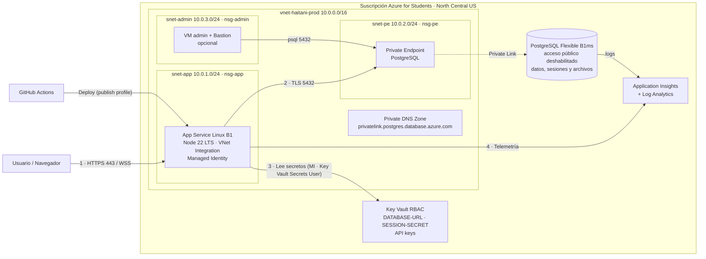

# Haitani · Infraestructura en Azure con Terraform

Infraestructura del proyecto integrador **Haitani** basada en la *Arquitectura de referencia Azure for Students (Landing Zone + Well-Architected)*, adaptada a lo que la aplicación usa realmente (Node.js + Express + WebSockets + PostgreSQL). **No requiere cambios en el código de la app.**

## Arquitectura



| Componente | Recurso | Detalle |
|---|---|---|
| Red | `vnet-haitani-prod` | 10.0.0.0/16 con `snet-app`, `snet-pe`, `snet-admin` y un NSG por subred |
| Cómputo | `app-haitani-prod-xxxx` | App Service Linux B1, Node 22 LTS, WebSockets, Always On, HTTPS only, TLS 1.2 |
| Salida privada | VNet Integration | `snet-app` delegada a `Microsoft.Web/serverFarms`, `vnet_route_all` |
| Base de datos | `psql-haitani-prod-xxxx` | PostgreSQL 16 Flexible Burstable B1ms, 32 GB, **sin acceso público** |
| Conectividad privada | Private Endpoint + Private DNS Zone | PostgreSQL en `snet-pe` (10.0.2.x) |
| Secretos | `kv-haitani-prod-xxxx` | Key Vault con RBAC; la app usa referencias `@Microsoft.KeyVault(...)` |
| Identidad | System-Assigned Managed Identity | Rol **Key Vault Secrets User** (solo lectura) |
| Monitoreo | `appi-haitani-prod` + `log-haitani-prod` | Telemetría, logs de consola/HTTP de la app y logs de PostgreSQL |
| Opcional | VM `vm-admin-haitani-prod` + Bastion Developer | Administración de la base privada con `psql` |
| Opcional | Presupuesto | Alertas de 50, 75 y 90 USD |

### Decisiones de diseño

- **Región North Central US**: Mexico Central está bloqueada por la política de Azure for Students.
- **Sin Blob Storage**: la app guarda los archivos en PostgreSQL (`multer.memoryStorage()` → tabla `stored_assets`), y las sesiones también (`connect-pg-simple` → `user_sessions`). Agregar Blob no aportaría nada sin cambiar el código.
- **Sin VM worker**: la app no tiene procesos en segundo plano, y el comando de arranque ejecuta `npm run db:init` (idempotente) antes de `npm start`, así que las tablas se crean solas. La VM de administración es opcional.
- **Node 22 LTS**: Node 20 terminó su soporte en abril de 2026.
- **PostgreSQL privado** en lugar de reglas de firewall: las IP salientes de App Service se comparten con otros clientes, así que el Private Endpoint es lo que realmente aísla la base.
- **Nombres con sufijo aleatorio** (`xxxx`) en App Service, PostgreSQL y Key Vault porque son únicos a nivel mundial.

## Variables de entorno que recibe la app

| Variable | Origen |
|---|---|
| `DATABASE_URL` | Key Vault (`DATABASE-URL`) |
| `SESSION_SECRET` | Key Vault (`SESSION-SECRET`, generado aleatoriamente) |
| `NODE_ENV` | `production` |
| `BASE_URL`, `CORS_ORIGIN`, `MERCADOPAGO_BACK_URL` | URL real de la app (paso `app_urls`) |
| `APPLICATIONINSIGHTS_CONNECTION_STRING` | Application Insights |
| `SANZU_API_URL`, `SANDBOX_MODE`, ... | `extra_app_settings` |
| `SANZU_API_KEY`, `MERCADOPAGO_*`, `GITHUB_*`, ... | `app_secrets` → Key Vault |

## Despliegue (Azure Cloud Shell, Bash)

```bash
unzip haitani-infra.zip -d infra && cd infra/haitani-infra
cp terraform.tfvars.example terraform.tfvars
code terraform.tfvars          # pon tus secretos opcionales

terraform init
terraform fmt
terraform validate
terraform plan -out tfplan
terraform apply tfplan         # ~15-20 min (PostgreSQL es lo más lento)
terraform output
```

## Desplegar la aplicación

**Opción A · Azure CLI** (la más rápida para la primera prueba). Desde la carpeta raíz del repo de la app:
```bash
git archive --format=zip -o app.zip HEAD -- . ':!terraform' ':!backups' ':!.github'
az webapp deploy -g rg-haitani-prod-ncus-001 -n <app_name> --src-path app.zip --type zip
```
`git archive` solo empaqueta lo que está en Git, así que nunca incluye `.env`, `terraform.tfvars` ni `node_modules`.

**Opción B · GitHub Actions (manual)**
1. Portal → App Service → **Descargar perfil de publicación**.
2. En el repo de la app: *Settings → Secrets and variables → Actions*
   - Secret `AZURE_WEBAPP_PUBLISH_PROFILE` = contenido del archivo descargado.
   - Variable `AZURE_WEBAPP_NAME` = `terraform output -raw app_name`.
3. *Actions → Deploy Haitani to Azure App Service → Run workflow*. Primero corre las pruebas y solo si pasan despliega.

El workflow es manual a propósito: producción sigue en Render con `ci-cd.yml`, que prueba cada push y despliega lo que llega a `main`.

## Verificación

```bash
RG=rg-haitani-prod-ncus-001
az resource list -g $RG -o table
az network vnet subnet list -g $RG --vnet-name vnet-haitani-prod --query "[].{subred:name, rango:addressPrefix}" -o table
az postgres flexible-server show -g $RG -n $(terraform output -raw postgres_fqdn | cut -d. -f1) --query "{acceso:network.publicNetworkAccess, sku:sku.name}" -o table
az webapp config appsettings list -g $RG -n $(terraform output -raw app_name) --query "[?contains(value,'KeyVault')].name" -o table
```

En el portal: App Service → **Variables de entorno** → `DATABASE_URL` y `SESSION_SECRET` deben mostrar el **check verde de Key Vault**.

## Problemas comunes

| Síntoma | Solución |
|---|---|
| `403 Forbidden` al crear secretos | Los permisos RBAC tardan; espera 1 min y repite `terraform apply` |
| Variables de Key Vault con ❌ rojo | El rol de la app tardó en propagarse: App Service → **Reiniciar** |
| La app no conecta a la base (`timeout`) | Revisa que la app tenga VNet Integration en `snet-app` y que exista el enlace de la zona DNS privada |
| Cuota de App Service al crear el plan | Reutiliza tu plan con `existing_service_plan_id` (debe ser Linux y estar en North Central US) |
| Error al crear el presupuesto | Tu suscripción no lo admite: deja `enable_budget = false` |

## Costos aproximados (24/7)

| Recurso | USD/mes |
|---|---|
| App Service B1 | ~13 |
| PostgreSQL B1ms + 32 GB | 0 con las 750 h gratis (solo 1 servidor) |
| Key Vault, DNS privado, Private Endpoint | ~8 (el endpoint cobra por hora) |
| Log Analytics / App Insights | 0 dentro de 5 GB/mes |
| VM admin (opcional, con apagado 23:00) | ~10 |

Para borrar todo: `terraform destroy`.

## Ubicación en el repositorio

Estos archivos viven en la carpeta `terraform/` del repositorio de Haitani, y el workflow en `.github/workflows/deploy-azure.yml`. Terraform se ejecuta a mano (Cloud Shell o Azure CLI local); la rama de Git no cambia lo que se crea en Azure.

Nunca se suben `terraform.tfvars`, `*.tfstate` ni `*.pem` (están en `.gitignore`).
